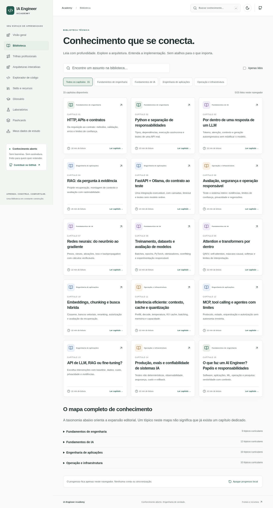
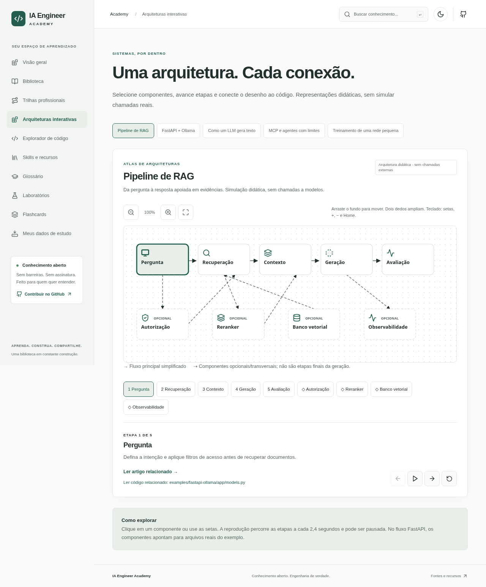
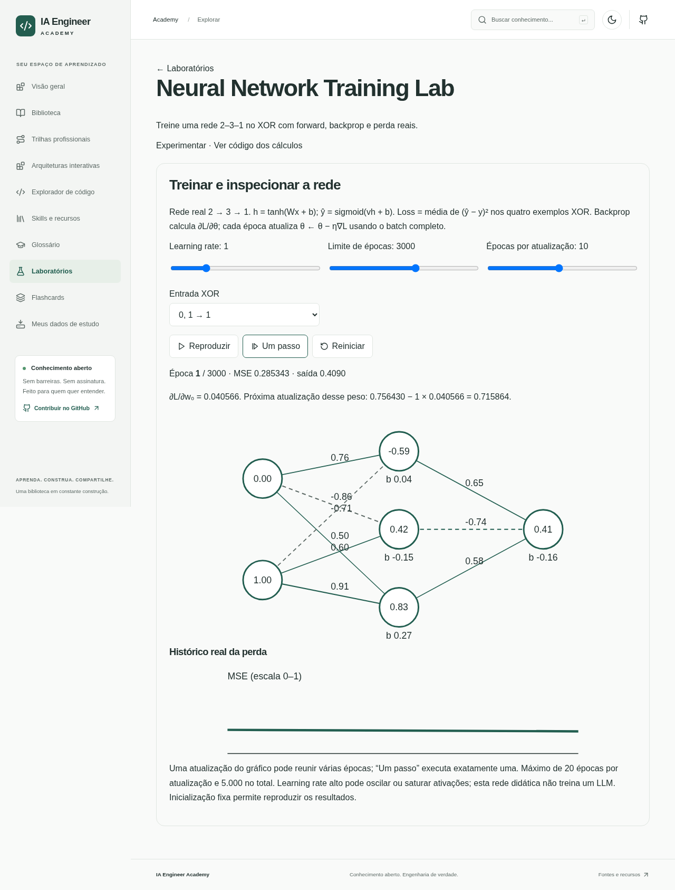

# IA Engineer Academy

[](https://github.com/AirtonNettu/ai-engineering-academy-/actions/workflows/quality.yml) [](LICENSE) [](https://ai-engineering-academy-3cy.pages.dev/)


**Da teoria à arquitetura, da arquitetura ao código, do código à compreensão.**

Plataforma educacional gratuita e open-source em português brasileiro. Estude aplicações, modelos e operação de IA sem conta ou pagamento. Leitura e laboratórios não dependem de Ollama, n8n, GPU ou backend público.

[**Acessar a plataforma**](https://ai-engineering-academy-3cy.pages.dev/) · [Biblioteca](https://ai-engineering-academy-3cy.pages.dev/biblioteca) · [Laboratórios](https://ai-engineering-academy-3cy.pages.dev/laboratorios)

## Estudar por dentro

- **15 capítulos** com três profundidades, fontes, código relacionado e glossário.
- **Quatro roadmaps**, percurso retomável e **45 flashcards** com revisão espaçada e backup local.
- **Três laboratórios**: rede XOR com backprop/SGD, attention Q/K/V e embeddings com cosseno/ranking. Cálculos reais, com limites didáticos explícitos.
- **Atlas com cinco arquiteturas** e explorador dos arquivos reais do exemplo Python/FastAPI/Ollama.
- Tema claro/escuro, teclado, navegação móvel e leitura estática dos capítulos sem JavaScript. Interações e dados de estudo usam JavaScript.

## A plataforma em telas reais

Capturas do build local desta consolidação, em 1280 px. São evidências da interface executada, não imagens geradas nem confirmação da versão publicada.

**Biblioteca**



**Atlas de Arquiteturas**



**Laboratório de rede neural**



## Executar e verificar

Node.js 24+:

```bash
npm ci
npm run dev
```

Build estático e verificações:

```bash
npm run check
npm run check:links
npm run check:performance
npx playwright install chromium
npm run test:e2e
```

`check` reúne lint, formato, testes com cobertura, validação editorial, TypeScript e build. A cobertura exige no mínimo 80% por módulo matemático e de estado local nas quatro métricas. `npm run preview` serve o build. Para o exemplo Python e testes sem Ollama, siga [seu guia](examples/fastapi-ollama/README.md).

## Contribuir e manter

Leia [CONTRIBUTING.md](CONTRIBUTING.md), [SECURITY.md](SECURITY.md) e [AGENTS.md](AGENTS.md). Mudanças passam por revisão; sem publicação automática de textos de IA, merge, deploy ou release. Progresso e revisões ficam neste navegador, sem sincronização ou telemetria; exporte backups.

[Guia completo](docs/platform-guide.md) · [Arquitetura](docs/architecture.md) · [Manutenção](docs/maintenance.md) · [Testes](docs/testing.md) · [Relatório de consolidação](docs/consolidation/report.md) · [Publicação](docs/deployment.md) · [Changelog](CHANGELOG.md)

A renomeação para `ai-engineering-academy` está apenas [preparada](docs/repository-rename-checklist.md), sujeita a autorização. O pacote npm `ia-engineer-academy` e a versão 1.0.0 foram preservados.

Código e textos originais sob [MIT](LICENSE). Fontes externas conservam suas licenças. Experimentos pequenos não demonstram generalização nem treinam um LLM; veja os limites no guia completo.
