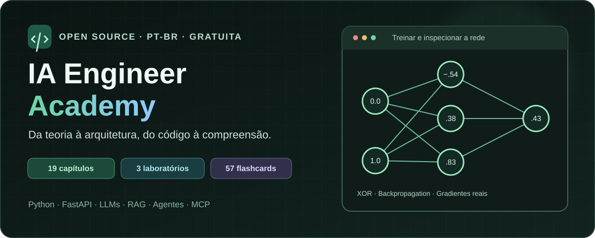
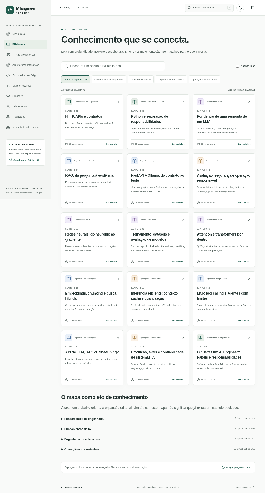
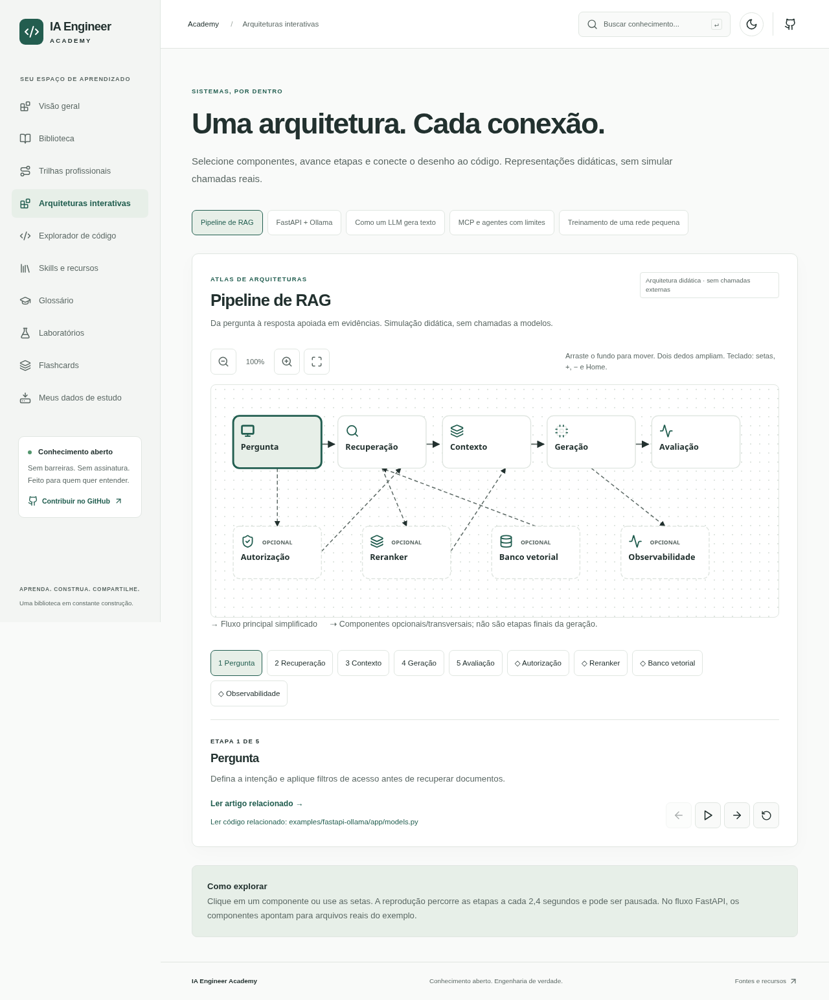
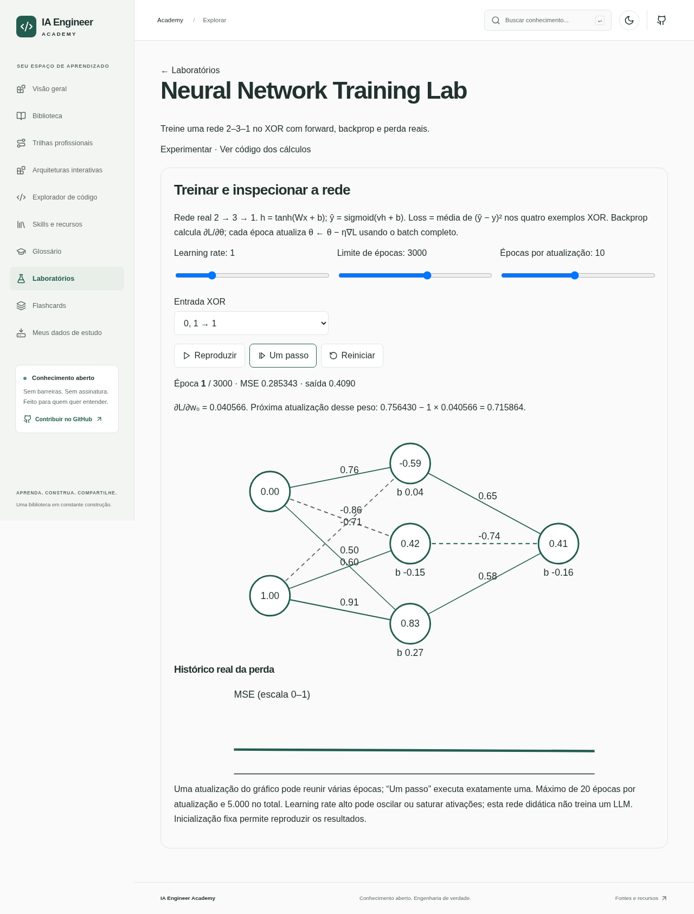

# IA Engineer Academy

[](https://github.com/AirtonNettu/ai-engineering-academy-/actions/workflows/quality.yml) [](LICENSE) [](https://ai-engineering-academy-3cy.pages.dev/)



**Da teoria à arquitetura, da arquitetura ao código, do código à compreensão.**

Plataforma educacional gratuita e open-source em português brasileiro. Estude aplicações, modelos e operação de IA sem conta ou pagamento. Leitura e laboratórios não dependem de Ollama, n8n, GPU ou backend público.

[**Acessar a plataforma**](https://ai-engineering-academy-3cy.pages.dev/) · [Biblioteca](https://ai-engineering-academy-3cy.pages.dev/biblioteca) · [Centro de Pesquisa](https://ai-engineering-academy-3cy.pages.dev/pesquisa) · [Observatório de IA](https://ai-engineering-academy-3cy.pages.dev/observatorio) · [Laboratórios](https://ai-engineering-academy-3cy.pages.dev/laboratorios)

## Estudar por dentro (Versão 2.0 — Research & Engineering)

- **19 capítulos** com três profundidades, fontes, código relacionado e glossário.
- **Centro de Pesquisa Científica** com 26 artigos seminais e contemporâneos, 16 modelos de pesos abertos e 10 datasets canônicos com proveniência comprovada.
- **Observatório de Inteligência Artificial** com benchmarks analíticos verificáveis (MMLU-Pro, GSM8K, HumanEval, Chatbot Arena ELO) e métricas padronizadas de serving (TTFT, tokens/s, VRAM em FP16 vs AWQ vs GGUF).
- **Atlas com nove arquiteturas interativas** (incluindo Mixture of Experts, Speculative Decoding, Ciclo Agêntico ReAct e RAG Híbrido) e explorador dos arquivos reais do exemplo Python/FastAPI/Ollama.
- **Quatro roadmaps**, percurso retomável e **57 flashcards** com revisão espaçada e backup local.
- **Três laboratórios didáticos**: rede XOR com backprop/SGD, attention Q/K/V e embeddings com cosseno/ranking. Cálculos reais, com limites didáticos explícitos.
- Tema claro/escuro, teclado, navegação móvel e leitura estática dos capítulos sem JavaScript. Interações e dados de estudo usam JavaScript.

## A plataforma em telas reais

Capturas do build local desta consolidação, em 1280 px. São evidências da interface executada, não imagens geradas nem confirmação da versão publicada.

**Biblioteca**



**Atlas de Arquiteturas**



**Laboratório de rede neural**



## Executar e verificar

Node.js 24+:

```bash
npm ci
npm run dev
```

Build estático e verificações:

```bash
npm run check
npm run check:links
npm run check:performance
npx playwright install chromium
npm run test:e2e
```

`check` reúne lint, formato, testes com cobertura, validação editorial, TypeScript e build. A cobertura exige no mínimo 80% por arquivo nas quatro métricas **apenas nos cinco módulos selecionados**: `src/labs/neural.ts`, `src/labs/attention.ts`, `src/labs/embeddings.ts`, `src/learning/model.ts` e `src/learning/scheduler.ts`. O resultado de 100% nesses módulos não é cobertura de todo o projeto, da interface ou do Python. Veja [escopo e lacunas de testes](docs/consolidation-coverage.md). `npm run preview` serve o build. Para o exemplo Python e testes sem Ollama, siga [seu guia](examples/fastapi-ollama/README.md).

## Contribuir e manter

Leia [CONTRIBUTING.md](CONTRIBUTING.md), [SECURITY.md](SECURITY.md) e [AGENTS.md](AGENTS.md). Mudanças passam por revisão; sem publicação automática de textos de IA, merge, deploy ou release. Progresso e revisões ficam neste navegador, sem sincronização ou telemetria; exporte backups.

[Índice de documentação](docs/README.md) · [Guia completo](docs/platform-guide.md) · [Arquitetura](docs/architecture.md) · [Manutenção](docs/maintenance.md) · [Testes](docs/testing.md) · [Publicação](docs/deployment.md) · [Changelog](CHANGELOG.md)

A renomeação para `ai-engineering-academy` está apenas [preparada](docs/repository-rename-checklist.md), sujeita a autorização. O pacote npm `ia-engineer-academy` encontra-se na versão 2.0.0.

Código e textos originais sob [MIT](LICENSE). Fontes externas conservam suas licenças. Experimentos pequenos não demonstram generalização nem treinam um LLM; veja os limites no guia completo.
