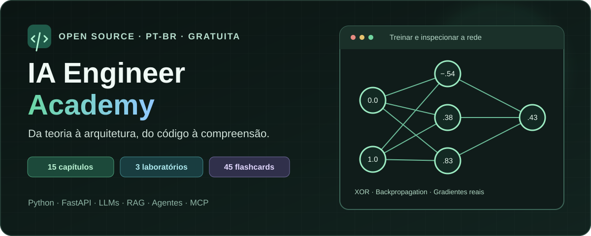

# IA Engineer Academy

[](https://github.com/AirtonNettu/ai-engineering-academy-/actions/workflows/quality.yml) [](LICENSE) [](https://ai-engineering-academy-3cy.pages.dev/)

<div align="center">



**Aprenda IA por dentro: teoria, código, arquiteturas e experimentos reais.**

[**🌐 Acessar a plataforma**](https://ai-engineering-academy-3cy.pages.dev/) · [**📚 Explorar a biblioteca**](https://ai-engineering-academy-3cy.pages.dev/biblioteca) · [**🧪 Experimentar os laboratórios**](https://ai-engineering-academy-3cy.pages.dev/laboratorios)

</div>

---

**Da teoria à arquitetura, da arquitetura ao código, do código à compreensão.**

A **IA Engineer Academy** é uma plataforma educacional **gratuita, open-source e em português brasileiro**, dedicada exclusivamente ao estudo de Inteligência Artificial e Engenharia de IA. Seu objetivo é explicar como a IA funciona, como construir aplicações com ela e como avaliar arquitetura, qualidade, segurança e operação.

**[Acesse a plataforma gratuitamente](https://ai-engineering-academy-3cy.pages.dev/)**. Para estudar, basta abrir o site pelo celular ou computador: não é necessário instalar nada, criar conta ou pagar.

## O que você encontra aqui?

- **Fundamentos e modelos de IA:** redes neurais, treinamento, tokens, embeddings, transformers e inferência.
- **Engenharia de aplicações:** Python, FastAPI, Ollama, RAG, agentes, MCP, avaliação e segurança.
- **Aprendizagem interativa:** artigos em três níveis, diagramas, código real, laboratórios, flashcards e trilhas profissionais.
- **Comunidade:** estudantes e desenvolvedores podem sugerir melhorias e contribuir com conteúdo e código.

Não é um chatbot nem um serviço pago de cursos ou treinamento de LLMs. Python e outras tecnologias são abordados como ferramentas para construir e compreender sistemas de IA, não como um catálogo genérico de linguagens.

## Para quem é?

A Academy atende desde iniciantes até desenvolvedores e profissionais que desejam aprofundar seus conhecimentos. Os conteúdos explicam conceitos, funcionamento interno, implementações e decisões de engenharia. A experiência é pública, sem login e sem backend obrigatório.

## Como contribuir

O projeto aceita propostas de artigos, correções, diagramas, laboratórios e melhorias técnicas. Leia [CONTRIBUTING.md](CONTRIBUTING.md), abra uma issue ou envie um pull request. As contribuições passam por revisão antes de serem publicadas.

## Para desenvolvedores: executar localmente

Os comandos abaixo são para quem deseja executar, testar ou contribuir com o código. **Não são necessários para estudar pelo site.**

Node.js 24+ (também em `.nvmrc`):

```bash
npm ci
npm run dev
```

Vite informa o endereço local, porta 5173 por padrão. Em ambientes com cache padrão não gravável: `npm ci --cache /tmp/academy-npm-cache`.

```bash
npm run build
npm run preview
```

Não há segredo ou `.env` obrigatório no frontend. `SITE_URL` é uma origem HTTPS opcional no build: necessária para canonical/sitemap e indexação de produção. Sem ela, robots bloqueia indexação de previews. Cloudflare Pages continua sendo o destino estático documentado; nenhum deploy é automático.

## Experiência de aprendizagem

- **Biblioteca:** 15 capítulos completos, seis originais enriquecidos sem trocar slugs ou remover headings, mais nove novos. Cada um tem fundamentação, funcionamento intermediário e análise avançada. Fontes, tempo de estudo, revisão, relações e implementação real relacionada.
- **Percurso:** “Estudar este assunto” abre seis etapas: três leituras, arquitetura, implementação e flashcards. Conclusão é explícita; é possível voltar, avançar sem concluir e retomar. A área de dados lista percursos recentes.
- **Revisão:** 45 cartões editoriais, frente/verso, acertei/errei, dificuldade, vencimentos e estatísticas das respostas reais. Erro agenda em dez minutos; acertos consecutivos em 1, 3, 7, 14 e 30 dias. Não há geração de cartões por IA ou medição automática de domínio.
- **Roadmaps:** AI Application Engineer, Machine Learning Engineer, MLOps/LLMOps Engineer e AI Research Engineer. Júnior/pleno/sênior são descritos por autonomia, responsabilidade, impacto e contexto, com pré-requisitos, entregáveis e leituras/labs. Não são checklists universais.
- **Atlas:** cinco fluxos (RAG, FastAPI/Ollama, LLM, MCP/agentes e treinamento da rede pequena), ícones SVG, seleção, setas, zoom/pan por toque/mouse/teclado, componentes opcionais e links a artigos/código real relacionado.
- **Código e pesquisa:** explorador FastAPI/Ollama preservado, fontes reais dos cálculos, busca de texto completo, conceitos, trilhas, laboratórios, arquiteturas, projetos, recursos, skills e referências. Glossário interligado e 17 recursos/skills com origem explícita.
- **Interface:** tema claro/escuro, fonte ajustável, controles por teclado, modo móvel e respeito a preferências de movimento reduzido.

## Laboratórios: cálculos reais no navegador

| Laboratório                 | Cálculo e controles                                                                                                                             | Limites didáticos                                                                                                 |
| --------------------------- | ----------------------------------------------------------------------------------------------------------------------------------------------- | ----------------------------------------------------------------------------------------------------------------- |
| Neural Network Training Lab | Rede 2–3–1 no XOR, tanh/sigmoid, MSE, gradientes, SGD em batch, pesos/ativações e curva real de perda; taxa, orçamento, passo, play/pause/reset | 13 parâmetros; até 5.000 épocas e 20 por atualização; não treina um LLM                                           |
| Attention Explorer          | Tokenização por espaços, vetores determinísticos, Q/K/V, produto escalonado, softmax estável, máscara causal, heatmap e saída ponderada         | Uma cabeça com dimensão 2; pesos fixos; não representa tokenização de um modelo comercial                         |
| Embedding Explorer          | Vetores editoriais 4D, cosseno e ranking reais, projeção 2D arrastável, pan/zoom, teclado e percurso dos resultados                             | Projeção manual não preserva distâncias originais; arrastar não altera vetores/ranking; não usa embeddings de LLM |

As páginas oferecem `?codigo=1` para ler os mesmos módulos TypeScript usados nos cálculos e comandos de teste. O [exemplo Python](examples/fastapi-ollama/README.md) continua separado: testes com mocks não precisam de Ollama, mas inferência real exige um modelo disponível.

## Dados locais e privacidade

Progresso anterior de leitura é migrado. O registro `academy:learning` mantém leituras, etapas e agenda; marcadores legados continuam compatíveis. A área **Meus dados de estudo** permite exportar/importar JSON validado, confirmar substituição e limpar estudo/revisões sem apagar tema, fonte ou dados de outros sites.

O navegador pode apagar dados. Não há sincronização entre dispositivos. Exporte backups; nenhum dado de estudo é enviado a terceiros. Falha de armazenamento é sinalizada e a sessão continua em memória. O relógio do dispositivo influencia vencimentos; intervalos são durações de 24 horas, não dias de calendário. [Formato e política](docs/learning-data.md).

## Estrutura

```text
content/                    # capítulos, catálogo, flashcards e contrato editorial
src/
  components/               # layout, Markdown, código e Atlas
  learning/                 # schema local, agendamento, contexto e revisão
  labs/                     # matemática pura, interfaces e playback limitado
  pages/                    # leitura, estudo, trilhas, labs, dados e pesquisa
  lib/                      # schemas, validação editorial e busca
  test/                     # matemática, estado, componentes e integração
examples/fastapi-ollama/     # API educacional Python e testes com mocks
scripts/                    # validação, metadados estáticos e propostas
public/                     # identidade, CSP/headers e fallback estático
e2e/                       # Playwright desktop/móvel e axe
.github/workflows/          # um workflow de qualidade, sem deploy
docs/                       # requisitos, ADRs, aceite e evidências
```

## Verificação

```bash
npm run check
npx playwright install chromium
npm run test:e2e
```

O check reúne ESLint, Prettier, Vitest, schema/links/camadas editoriais, TypeScript e build. Em máquina com Chromium já instalado: `PLAYWRIGHT_CHROMIUM_EXECUTABLE_PATH=/usr/bin/chromium npm run test:e2e`. Não desative verificação TLS para instalar ferramentas.

Python: siga o README do exemplo; instale `requirements.lock.txt` em um ambiente virtual e execute `python -m pytest -q`. O pytest.ini da raiz também encontra a suíte.

Veja [aceite da Issue #2](docs/issue-2-acceptance.md), [testes](docs/testing.md), [arquitetura](docs/architecture.md), [cobertura editorial](docs/content-coverage.md), [modelo de conteúdo](docs/content-model.md), [contribuição](CONTRIBUTING.md), [deploy futuro](docs/deployment.md) e [automação editorial](docs/editorial-automation.md).

## Limites declarados

Os artigos não são cursos completos de cada tecnologia. Experimentos pequenos não demonstram generalização nem qualidade de modelos em produção. Os diagramas não executam integrações administrativas; n8n/Ollama/GitHub editorial permanecem contratos e documentação, com revisão humana obrigatória. Sem publicação automática, treino de LLM, serving distribuído, certificações, sincronização ou garantia de retenção.

A aplicação depende de JavaScript; há metadados específicos por rota, sem SSR completo do texto. Navegadores emulados e axe não substituem aparelho físico/leitor de tela. Publicação, domínio real, headers efetivos no provedor e inferência Ollama real dependem de configuração/autorização externas. As referências oficiais estão citadas; disponibilidade de todos os destinos externos não foi auditada nesta sessão.

## Licença

Código e textos originais sob [MIT](LICENSE). Fontes externas mantêm suas próprias licenças; citar não autoriza reproduzir material protegido. Não utilizamos capítulos de livros sem autorização.
