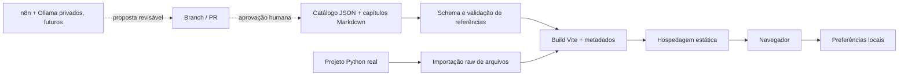

# Arquitetura

## Decisão principal

Site estático construído com React 19, TypeScript estrito e Vite. React Router controla URLs; cada rota editorial recebe um HTML de entrada com metadados específicos. Cloudflare Pages é o destino estático informado pelo proprietário; configuração remota não foi acessível nesta revisão. Esta branch não publica. Não há backend público, banco de dados, login, coleta de analytics ou execução remota de código.

## Limites dos módulos

`content/catalog.json` contém os metadados; `content/chapters/*.md` contém prosa original. `src/lib/content.ts` valida e tipa a taxonomia e as relações. `search.ts` constrói um índice de metadados e texto completo em memória com normalização Unicode e ranking simples, sem biblioteca de busca adicional. `storage.ts` recupera falhas de armazenamento e valida progresso.

`Markdown` não permite HTML, MDX executável ou imagens remotas. `CodeBlock` renderiza tokens como spans React, sem dangerouslySetInnerHTML. Shiki usa engine JavaScript, não eval/wasm; carrega sob demanda com quatro gramáticas necessárias (Python, JSON, shell e TypeScript). HTTP e texto têm fallback legível. Lucide é importado por ícone e sofre tree-shaking.

Diagramas usam SVG com componentes selecionáveis, ícones, setas, pan/zoom por ponteiro e controles de teclado. O estado distingue etapa principal de componentes opcionais/transversais. A reprodução é didática e explícita. React Flow foi avaliado, mas não é necessário para os pequenos grafos sem edição geral. O Atlas adiciona MCP/agentes e treinamento de uma rede pequena sem confundir isso com inferência de LLM.

O explorador deriva a árvore dos metadados, importa os arquivos reais sob `examples/fastapi-ollama` e exibe explicações de responsabilidade/símbolos/imports versionadas. A validação confirma que os arquivos existem. Não executa o Python no navegador.

## Exemplo Python isolado

`create_app` compõe Settings, AsyncClient e OllamaService com lifespan. Rota conhece contrato público; adaptador conhece protocolo do Ollama. Dependência de transporte é injetável. Testes usam HTTPX MockTransport. Não há dependência do exemplo para servir o site.

## Estado e privacidade

Tema, tamanho de fonte e marcações de leitura usam chaves `academy:*` no localStorage. Falha/quota/JSON corrompido não bloqueia a leitura. Não há sincronização entre dispositivos. O usuário pode apagar o progresso na biblioteca. Links externos usam noopener/noreferrer. As fontes e referências são acessadas apenas quando o visitante as abre.

## Segurança

Headers em `public/_headers` definem CSP restrita, nosniff, DENY, referrer policy e permissões mínimas. CSS inline é permitido para cores dos tokens e tamanho do leitor, mas scripts inline não. Não há segredos em VITE_*. A API de exemplo não aceita URLs arbitrários do usuário e não segue redirects do upstream.

## SEO e performance

Build gera HTML com title/description por rota e canonical/sitemap quando SITE_URL está definido. Sem domínio aprovado, robots bloqueia indexação. O build pré-renderiza os 15 capítulos com ReactMarkdown seguro para leitura sem JS. O mesmo root é substituído pelo React no navegador, sem hidratação parcial. Interações e demais páginas continuam em React; não há SSR em execução. Frontend não baixa modelos. Não há fontes externas nem imagens pesadas. Código do exemplo e capítulos são carregados conforme a navegação; o realce é um chunk separado. Arquivos de assets com hash podem ser cacheados por um ano.

## Alternativas e justificativas

MDX foi descartado para evitar código em material editorial; react-markdown fornece parsing seguro sem HTML bruto. Backend/CMS e banco vetorial foram descartados para o site por não haver necessidade; a busca lexical resolve a escala atual. Vitest/Testing Library, Playwright e axe verificam camadas complementares. mdast-util-from-markdown (já utilizado pelo renderer) valida links por AST sem regex parcial. Zod evita divergência entre tipos e validação, e gera o JSON Schema de propostas futuras.

## Aprendizagem avançada

`src/learning` separa conteúdo editorial de estado privado. LearningProvider migra leitura e distribui leituras/etapas/revisões; model.ts valida backup, scheduler.ts calcula intervalos com relógio explícito. As páginas de estudo e flashcards são lazy routes. Backups usam Blob local e File API; não há upload remoto. Armazenamento indisponível gera aviso, mantendo sessão em memória. Não há sincronização multiaba/dispositivo.

`src/labs` contém funções puras e componentes independentes. Rede 2–3–1 XOR usa tanh/sigmoid/MSE e gradiente batch; atenção calcula projeções, scores, softmax e saída; embeddings usa vetores manuais e ranking em 4D. SVG é apenas visualização; o layout 2D não altera os dados originais. `SourcePreview` e a página de laboratório exibem os módulos reais por importação raw. Os dados inteiros permanecem pequenos; não são baixados pesos ou fontes de terceiros.

ADRs e limites em [ADR 0004](adr/0004-advanced-learning.md), [dados locais](learning-data.md) e [aceite](issue-2-acceptance.md). As URLs anteriores permanecem. Novas rotas: /laboratorios, /laboratorios/:labId, /estudar/:id, /flashcards e /meus-dados. Metadados estáticos incluem páginas públicas dos labs; URLs de dados privados e percurso não entram no sitemap.

Detalhes e evidências da consolidação: [ADR 0005](adr/0005-static-reading-and-quality.md) e [relatório](consolidation/report.md).
