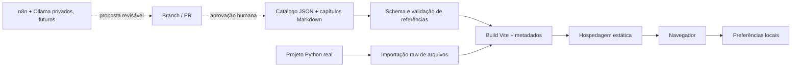

# Arquitetura

## Decisão principal

Site estático construído com React 19, TypeScript estrito e Vite. React Router controla URLs; cada rota editorial recebe um HTML de entrada com metadados específicos. Cloudflare Pages é destino futuro, sem deploy configurado. Não há backend público, banco de dados, login, coleta de analytics ou execução remota de código.

## Limites dos módulos

`content/catalog.json` contém os metadados; `content/chapters/*.md` contém prosa original. `src/lib/content.ts` valida e tipa a taxonomia e as relações. `search.ts` constrói um índice de metadados e texto completo em memória com normalização Unicode e ranking simples, sem biblioteca de busca adicional. `storage.ts` recupera falhas de armazenamento e valida progresso.

`Markdown` não permite HTML, MDX executável ou imagens remotas. `CodeBlock` renderiza tokens como spans React, sem dangerouslySetInnerHTML. Shiki usa engine JavaScript, não eval/wasm; carrega sob demanda com três gramáticas necessárias (Python, JSON, shell). HTTP e texto têm fallback legível. Lucide é importado por ícone e sofre tree-shaking.

Diagramas são componentes HTML com botões e conectores; o estado é o índice da etapa. React Flow foi avaliado, mas seria desnecessário para fluxos lineares fixos. Não há drag-and-drop que precise de um editor de grafos. O contrato de dados permite novos diagramas.

O explorador deriva a árvore dos metadados, importa os arquivos reais sob `examples/fastapi-ollama` e exibe explicações de responsabilidade/símbolos/imports versionadas. A validação confirma que os arquivos existem. Não executa o Python no navegador.

## Exemplo Python isolado

`create_app` compõe Settings, AsyncClient e OllamaService com lifespan. Rota conhece contrato público; adaptador conhece protocolo do Ollama. Dependência de transporte é injetável. Testes usam HTTPX MockTransport. Não há dependência do exemplo para servir o site.

## Estado e privacidade

Tema, tamanho de fonte e marcações de leitura usam chaves `academy:*` no localStorage. Falha/quota/JSON corrompido não bloqueia a leitura. Não há sincronização entre dispositivos. O usuário pode apagar o progresso na biblioteca. Links externos usam noopener/noreferrer. As fontes e referências são acessadas apenas quando o visitante as abre.

## Segurança

Headers em `public/_headers` definem CSP restrita, nosniff, DENY, referrer policy e permissões mínimas. CSS inline é permitido para cores dos tokens e tamanho do leitor, mas scripts inline não. Não há segredos em VITE_*. A API de exemplo não aceita URLs arbitrários do usuário e não segue redirects do upstream.

## SEO e performance

Build gera HTML com title/description por rota e canonical/sitemap quando SITE_URL está definido. Sem domínio aprovado, robots bloqueia indexação. A aplicação depende de JS; SSR/prerender editorial completo não foi implementado. Frontend não baixa modelos. Não há fontes externas nem imagens pesadas. Código do exemplo e capítulos são carregados conforme a navegação; o realce é um chunk separado. Arquivos de assets com hash podem ser cacheados por um ano.

## Alternativas e justificativas

MDX foi descartado para evitar código em material editorial; react-markdown fornece parsing seguro sem HTML bruto. Backend/CMS e banco vetorial foram descartados para o site por não haver necessidade; a busca lexical resolve a escala atual. Vitest/Testing Library, Playwright e axe verificam camadas complementares. mdast-util-from-markdown (já utilizado pelo renderer) valida links por AST sem regex parcial. Zod evita divergência entre tipos e validação, e gera o JSON Schema de propostas futuras.
