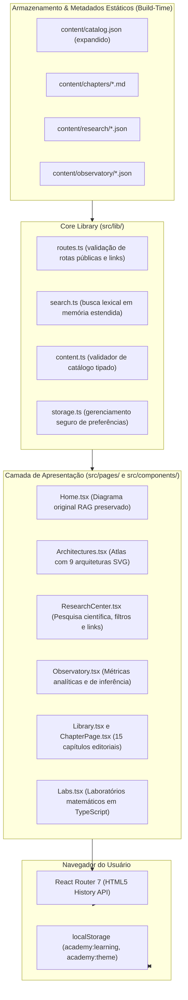

# Arquitetura Técnica e Contratos de Dados — IA Engineer Academy 2.0

## Desenho Arquitetural, Topologia de Componentes e Interfaces TypeScript Estritas

Este documento especifica a arquitetura técnica da versão 2.0 e os contratos de dados formais em TypeScript estrito, garantindo tipagem consistente, integridade de schema e desacoplamento entre módulos.

---

## 1. Desenho Arquitetural da Plataforma 2.0

A arquitetura preserva o paradigma de **plataforma educacional estática**, sem servidor Node.js em produção, aproveitando ao máximo as capacidades do navegador moderno:



### Princípios Técnicos:

1. **Lazy Loading Total para Novas Rotas:** `ResearchCenter` e `Observatory` são importados com `React.lazy()` em `src/App.tsx`, garantindo que o bundle principal da plataforma não sofra aumento de tamanho para usuários visitando apenas a Home ou Biblioteca.
2. **Separação entre Dados e Renderização:** Todo dado analítico ou científico reside em arquivos JSON validados por schemas TypeScript estritos. Nenhum componente React contém dados científicos hardcoded em seu JSX.
3. **Reaproveitamento de Componentes de Layout:** As novas páginas utilizam os componentes consolidados `PageIntro`, `Cards.tsx`, `CodeBlock.tsx` e `SourcePreview.tsx`.

---

## 2. Contratos de Dados TypeScript Estritos

Abaixo são definidos os contratos que serão materializados em `src/types/`:

### 2.1 Módulo de Pesquisa Científica (`src/types/research.ts`)

```typescript
/**
 * src/types/research.ts
 * Contratos de dados formais para o Centro de Pesquisa Científica da IA Engineer Academy 2.0
 */

export type PeerReviewStatus =
  'peer-reviewed' | 'preprint' | 'technical-report';

export type ScientificField =
  | 'transformers-attention'
  | 'rag-retrieval'
  | 'efficient-inference'
  | 'reasoning-alignment'
  | 'mixture-of-experts'
  | 'agents-tool-use';

export interface Author {
  readonly name: string;
  readonly institution?: string;
  readonly orcid?: string;
}

export interface ResearchPaper {
  readonly id: string; // Ex: 'attention-is-all-you-need'
  readonly title: string;
  readonly originalTitle: string;
  readonly authors: readonly Author[];
  readonly publicationDate: string; // Formato YYYY-MM
  readonly venue: string; // Ex: 'NeurIPS 2017', 'arXiv cs.CL'
  readonly status: PeerReviewStatus;
  readonly doi?: string;
  readonly arxivId?: string;
  readonly canonicalUrl: string;
  readonly openAccessPdfUrl: string;
  readonly field: ScientificField;
  readonly abstractPtBr: string;
  readonly keyFindings: readonly string[];
  /** Conexões pedagógicas com o ecossistema existente */
  readonly connections: {
    readonly chapterId?: string; // ID do capítulo em content/chapters/
    readonly diagramId?: string; // ID do diagrama do Atlas
    readonly labId?: string; // ID do laboratório interativo
    readonly relatedProject?: string; // Ex: 'fastapi-ollama'
  };
}

export interface ModelMetadata {
  readonly id: string; // Ex: 'llama-3-8b-instruct'
  readonly name: string;
  readonly organization: string;
  readonly releaseDate: string;
  readonly license: string; // Ex: 'Llama 3 Community', 'Apache-2.0'
  readonly architecture: string; // Ex: 'Decoder-only Transformer with RoPE & GQA'
  readonly parameterCount: string; // Ex: '8B'
  readonly contextWindow: number; // Ex: 8192 ou 131072
  readonly primaryPaperId?: string; // Referência a ResearchPaper.id
  readonly huggingFaceUrl?: string;
  readonly openWeights: boolean;
}

export interface DatasetMetadata {
  readonly id: string; // Ex: 'fineweb-edu'
  readonly name: string;
  readonly createdBy: string;
  readonly modality: 'text' | 'code' | 'multimodal' | 'evaluation';
  readonly tokenCountOrSize: string; // Ex: '1.3T tokens' ou '15 GB'
  readonly license: string;
  readonly primaryPaperId?: string;
  readonly url: string;
}
```

---

### 2.2 Módulo do Observatório de IA (`src/types/observatory.ts`)

```typescript
/**
 * src/types/observatory.ts
 * Contratos para o Observatório de Métricas Verificáveis da IA Engineer Academy 2.0
 */

export type HardwareTier =
  'consumer-gpu' | 'pro-workstation' | 'datacenter-cluster';

export interface BenchmarkScore {
  readonly benchmarkName:
    'MMLU-Pro' | 'GSM8K' | 'HumanEval' | 'MATH' | 'Chatbot-Arena-ELO';
  readonly score: number;
  readonly maxScore?: number;
  readonly evaluationMethod:
    'few-shot' | 'zero-shot' | 'cot' | 'elo-crowdsourced';
  readonly sourceUrl: string;
  readonly recordedDate: string;
}

export interface ModelObservatoryEntry {
  readonly modelId: string; // Referência a ModelMetadata.id
  readonly modelName: string;
  readonly category: 'open-weights' | 'proprietary-api';
  readonly benchmarks: readonly BenchmarkScore[];
  /** Métricas de engenharia e inferência documentadas */
  readonly inferenceMetrics: readonly {
    readonly engine: 'vLLM' | 'Ollama' | 'TGI' | 'SGLang';
    readonly hardware: string; // Ex: 'NVIDIA RTX 4090 24GB' ou '1x A100 80GB'
    readonly quantization: 'FP16' | 'BF16' | 'AWQ-4bit' | 'GGUF-Q4_K_M';
    readonly ttftMs: number; // Time to First Token (ms)
    readonly decodeTokensPerSec: number; // Throughput de geração (tokens/s)
    readonly vramUsageGb: number; // Consumo de memória de vídeo
    readonly contextLengthTested: number; // Janela de contexto no teste
    readonly sourceNotes: string;
  }[];
}
```

---

### 2.3 Módulo de Extensão do Atlas (`src/types/atlas.ts`)

```typescript
/**
 * src/types/atlas.ts
 * Extensão dos tipos do Atlas interativo existente (src/components/Diagram.tsx)
 */

export interface DiagramStep {
  readonly step: number;
  readonly title: string;
  readonly description: string;
  readonly activeNodes: readonly string[];
  readonly codeHighlight?: {
    readonly file?: string;
    readonly lines?: readonly number[];
  };
}

export interface AtlasArchitectureDefinition {
  readonly id: string; // Ex: 'moe', 'speculative', 'agents-react', 'hybrid-rag'
  readonly title: string;
  readonly category:
    'model-architecture' | 'serving-optimization' | 'system-pipeline';
  readonly summary: string;
  readonly relatedChapterId: string;
  readonly steps: readonly DiagramStep[];
  readonly technicalNotes: readonly string[];
}
```

---

## 3. Garantia de Tipagem e Testabilidade

1. **Validação Estática em Build-Time:** Um script dedicado (`scripts/validate-v2-data.ts`) utilizará a tipagem estrita para auditar todos os arquivos JSON sob `content/research/` e `content/observatory/` antes do build, falhando o processo com código de erro diferente de zero caso haja campos obrigatórios ausentes ou tipos inválidos.
2. **Zero `any`:** O projeto mantém `strict: true` e `noImplicitAny: true` em `tsconfig.json`. Todas as funções auxiliares de mapeamento e filtragem utilizam genéricos estritos e imutabilidade (`readonly`).
