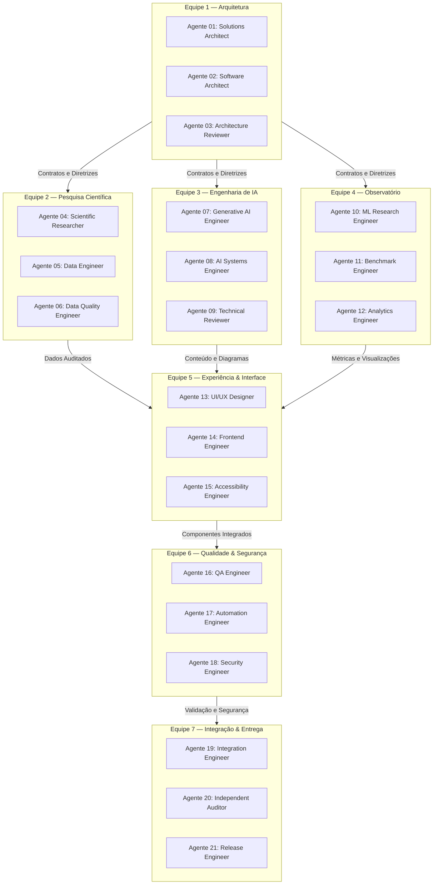

# Plano Mestre de Implementação — IA Engineer Academy 2.0

## Missão de Engenharia Multiagente (Research & Engineering)

Este documento estabelece o plano mestre para o desenvolvimento e implantação da **IA Engineer Academy 2.0**. Ele define o modelo operacional das 7 equipes e 21 agentes especializados, o sequenciamento em 5 fases, as dependências críticas, as salvaguardas de isolamento e os quality gates de entrega.

---

## 1. Visão Geral e Objetivos Estratégicos

A versão 2.0 expande a plataforma com 5 pilares estruturantes:

1. **Centro de Pesquisa Científica:** Catálogo auditado de papers seminais, modelos de ML e datasets abertos, estabelecendo o fluxo pedagógico: **Pesquisa (Fundamentos) → Teoria (Capítulos) → Modelo (Pesos/Arquitetura) → Experimento (Laboratórios/Código)**.
2. **Expansão do Atlas de Sistemas:** Quatro novas arquiteturas interativas essenciais para engenheiros de IA contemporâneos (Mixture of Experts - MoE, Speculative Decoding / KV-Cache Sharing, Agentic Loops com Tool Calling & Memory, e RAG Híbrido com Busca Vetorial Densa + BM25 Esparsa + Reranker Cross-Encoder).
3. **Observatório de IA com Métricas Verificáveis:** Painel de métricas analíticas e de engenharia de sistemas (throughput tokens/s, latência TTFT vs decode, pegada de VRAM em quantização AWQ/GPTQ/GGUF, e benchmarks canônicos de capacidade: MMLU-Pro, GSM8K, HumanEval, Chatbot Arena), com rastreabilidade formal para fontes abertas reprodutíveis.
4. **Expansão Editorial de IA Generativa:** Aprofundamento dos capítulos editoriais com novos módulos sobre raciocínio estruturado (_chain-of-thought_ / modelos de raciocínio), fine-tuning eficiente (_parameter-efficient fine-tuning_ via LoRA/QLoRA), frameworks de avaliação automatizada (_LLM-as-a-judge_ calibrado) e inferência em larga escala com vLLM e SGLang.
5. **Integração Unificada sem Duplicação:** Extensão do sistema de rotas estáticas (`routes.ts`), da busca em memória (`search.ts`) e do armazenamento local (`storage.ts`), sem duplicar bibliotecas, componentes ou estruturas.

---

## 2. Topologia Operacional das 7 Equipes e 21 Agentes

A equipe multiagente é distribuída em 7 frentes funcionais para garantir especialização, paralelismo seguro e separação de responsabilidades:

---

## 3. Sequenciamento do Projeto em 5 Fases

### Fase 1: Arquitetura, Contratos e Governança (Fase Atual)

- **Foco:** Especificação de requisitos, ADRs, contratos TypeScript, avaliação de APIs científicas e plano mestre.
- **Entregáveis:** Pasta `docs/v2/` completa, tipos base em `src/types/` declarados conceitualmente nos contratos, alinhamento com o proprietário.
- **Critério de Saída (Gate 1):** Aprovação explícita do proprietário do repositório para início do código executável.

### Fase 2: Fundamentos de Dados, Modelos e Conteúdo Científico

- **Foco:** Ingestão offline de metadados de papers, modelos e datasets abertos; elaboração editorial dos aprofundamentos de IA generativa; catálogo de métricas do observatório.
- **Responsáveis:** Equipes 2 (Pesquisa), 3 (Engenharia de IA) e 4 (Observatório).
- **Entregáveis:** Arquivos de dados estáticos (`content/research/*.json`, `content/observatory/*.json`), capítulos expandidos em `content/chapters/*.md`.
- **Critério de Saída (Gate 2):** Validação de integridade referencial, licenças abertas confirmadas, zero dados fabricados, schemas 100% aderentes.

### Fase 3: Expansão do Atlas e Visualizações do Observatório

- **Foco:** Implementação das 4 novas arquiteturas em SVG interativo sem duplicação de componentes; implementação dos painéis analíticos do Observatório com gráficos SVG acessíveis; prototipação do Centro de Pesquisa.
- **Responsáveis:** Equipe 5 (UI/UX, Frontend, Acessibilidade) com apoio das Equipes 3 e 4.
- **Entregáveis:** Rotas `/pesquisa`, `/observatorio`, expansão de `/arquiteturas` via query params (`?diagrama=moe`, etc.), testes de acessibilidade (teclado, ARIA, contraste, reduced-motion).
- **Critério de Saída (Gate 3):** Passar em testes unitários e de acessibilidade com axe, navegação completa sem erros de console, responsividade mobile verificada.

### Fase 4: Integração Sistêmica, Busca Unificada e Laboratórios

- **Foco:** Indexação dos novos conteúdos na busca em memória (`search.ts`); interligação bidirecional dos links (Paper ↔ Capítulo ↔ Arquitetura ↔ Exemplo de Código); validação de links estáticos (`check-links.ts`).
- **Responsáveis:** Equipe 7 (Integration Engineer) com suporte das Equipes 1, 5 e 6.
- **Entregáveis:** Roteador público atualizado (`publicRoutes`), cross-referencing validado, cobertura de testes unitários preservada nos limites configurados.
- **Critério de Saída (Gate 4):** `npm run check` verde com zero erros de tipo, formatação e links quebrados.

### Fase 5: Auditoria Independente, Consolidação e Release

- **Foco:** Auditoria técnica rigorosa por agente independente; testes E2E completos com Playwright; verificação de performance no Lighthouse; verificação de segurança (CSP, sanitização, ausência de credenciais); preparação do PR final.
- **Responsáveis:** Equipe 6 (QA, Automação, Segurança) e Equipe 7 (Auditor Independente, Release Engineer).
- **Entregáveis:** Relatório de auditoria independente, suite E2E passando com novos fluxos, PR formalmente aberto para aprovação do mantenedor.
- **Critério de Saída (Gate 5):** Autorização explícita do proprietário para consolidação na branch `main`.

---

## 4. Matriz de Dependências Inter-Equipes

| Equipe Dependente           | Depende de             | Recurso / Entrega Necessária                                      | Mecanismo de Bloqueio                                     |
| :-------------------------- | :--------------------- | :---------------------------------------------------------------- | :-------------------------------------------------------- |
| **Equipe 2 (Pesquisa)**     | Equipe 1 (Arquitetura) | Contratos TypeScript (`ResearchItem`, `ModelMeta`, `DatasetMeta`) | Não escrever JSONs antes do schema estar validado.        |
| **Equipe 3 (Eng. IA)**      | Equipe 1 (Arquitetura) | Modelo de taxonomia e regras de extensibilidade do Atlas          | Não alterar `content/catalog.json` sem seguir o schema.   |
| **Equipe 4 (Observatório)** | Equipe 1 (Arquitetura) | Contrato de dados de métricas (`BenchmarkResult`, `SystemMetric`) | Não compilar métricas sem proveniência de fonte.          |
| **Equipe 5 (Frontend)**     | Equipes 2, 3 e 4       | Dados compilados e validados                                      | Telas são construídas sobre dados estáticos validados.    |
| **Equipe 6 (Qualidade)**    | Equipe 5 (Frontend)    | Componentes e rotas finalizadas                                   | Testes E2E executam sobre rotas estáveis.                 |
| **Equipe 7 (Integração)**   | Todas as equipes       | Submissões revisadas e testadas                                   | Merge para branch de integração apenas com testes verdes. |

---

## 5. Protocolo de Governança e Regras de Branches

1. **Branch Baseline:** `main` consolidada no commit `d338b12187092d5b8aaf2d533122f5946c9bf3d6`.
2. **Branch de Trabalho da Fase 1 (Planejamento):** `feat/v2-architecture-plan`.
3. **Branches de Desenvolvimento de Tarefas:** Cada pacote de entrega utilizará branch de tarefa dedicada (ex: `feat/v2-research-center`, `feat/v2-atlas-expansion`, `feat/v2-observatory`), nunca alterando diretamente a `main`.
4. **Worktrees e Isolamento:** Para tarefas executadas em paralelo, utilizar branches isoladas garantindo que conflitos de arquivo sejam detectados antes da integração.
5. **Revisão Cruzada Obrigatória:** Todo artefato técnico (código, JSON ou documentação) de um agente deve ser submetido à revisão explícita de um agente parceiro pré-definido antes de ser incorporado.
6. **Zero Merge sem Aprovação:** Nenhuma alteração é incorporada na `main` sem validação completa e autorização explícita do proprietário.
