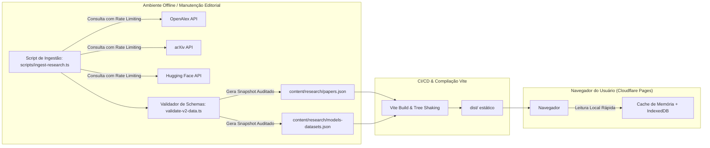

# Avaliação Técnica de APIs Científicas e Governança de Dados — IA Engineer Academy 2.0

## Análise de Viabilidade, Cotas R$ 0, Licenças e Estratégia de Fallback Estático

Este documento analisa as fontes candidatas de dados científicos e metadados de inteligência artificial para o **Centro de Pesquisa** e o **Observatório de IA**, estabelecendo as regras de licenciamento, limites operacionais e a arquitetura de ingestão desacoplada.

---

## 1. Diretrizes Inegociáveis de Engenharia

Em total consonância com [AGENTS.md](../../AGENTS.md) e [requirements.md](requirements.md):

1. **Custo Zero Absoluto (R$ 0):** Proibição do uso de APIs que exijam dados de cartão de crédito, assinaturas pagas ou cobrança por volume.
2. **Zero Segredos no Frontend:** O código do cliente (executado no navegador via Cloudflare Pages) não deve conter chaves de API secretas em variáveis de ambiente `VITE_*` nem embutidas no JavaScript.
3. **Imunidade a Falhas de Rede e Rate Limits:** A aplicação web não deve realizar chamadas diretas síncronas a APIs externas de terceiros para renderizar a página inicial ou suas listagens centrais.
4. **Isolamento via Compilação Estática (Build-Time Snapshot):** Os dados científicos e analíticos devem ser extraídos via scripts de compilação ou curadoria auditada, gerando arquivos JSON validados e versionados no repositório (`content/research/*.json` e `content/observatory/*.json`).

---

## 2. Avaliação Comparativa das Fontes Científicas Candidatas

| Fonte Candidata                    | Entidades Disponíveis                                                                           | Modelo de Custo                                                                               | Limites / Cotas (Rate Limit)                                                                         | Licença dos Dados                                                                            | Viabilidade no Academy 2.0                                                                             |
| :--------------------------------- | :---------------------------------------------------------------------------------------------- | :-------------------------------------------------------------------------------------------- | :--------------------------------------------------------------------------------------------------- | :------------------------------------------------------------------------------------------- | :----------------------------------------------------------------------------------------------------- |
| **OpenAlex API**                   | Trabalhos científicos, autores, instituições, citações, tópicos e conceitos.                    | **Gratuito / Aberto** (R$ 0). Não exige chave obrigatória para uso moderado.                  | 100.000 requisições/dia (com "polite pool" informando e-mail no cabeçalho `User-Agent` / `mailto:`). | **CC0 (Domínio Público)**. Dados 100% livres para reutilização e redistribuição.             | **EXCELENTE (Fonte Primária).** Ideal para metadados padronizados de literatura de IA.                 |
| **arXiv API**                      | Artigos, preprints de IA (cs.AI, cs.LG, cs.CL, cs.CV), autores, abstracts e datas.              | **Gratuito / Aberto** (R$ 0).                                                                 | Máximo de 1 requisição a cada 3 segundos (estritamente controlado).                                  | Metadados em **CC0 / Acesso Aberto**. PDFs sob licenças específicas dos autores (arXiv.org). | **ALTA (Fonte Primária para Preprints).** Usada com script de ingestão com _throttling_ offline.       |
| **Hugging Face Hub API**           | Metadados de modelos (pesos abertos), datasets, benchmarks e cartões de modelo (_model cards_). | **Gratuito / Aberto** para dados públicos (R$ 0).                                             | Endpoints públicos `/api/models` e `/api/datasets` com limites generosos para leitura.               | Depende do modelo/dataset (filtrar estritamente por Apache 2.0, MIT, OpenRAIL).              | **ALTA (Fonte para Modelos/Datasets).** Ingestão estática dos modelos abertos mais referenciados.      |
| **Semantic Scholar API**           | Artigos científicos, contagem de citações influentes, gráficos de referências.                  | Gratuito mediante chave pessoal básica; rate limits restritivos para chave anônima (1 req/s). | 1 req/s sem chave; 10 req/s com chave de parceiro.                                                   | ODC-BY / termos acadêmicos específicos.                                                      | **MÉDIA (Fonte Secundária).** Pode ser consultada pontualmente em scripts offline para enriquecimento. |
| **Papers with Code (PwC Archive)** | Vinculação direta de papers a código, tabelas de líderes e datasets.                            | **Gratuito / Aberto** (R$ 0). Exportações completas disponíveis em JSON/gzip.                 | Dados públicos via GitHub / Open Datasets.                                                           | **CC-BY-SA 4.0**. Requer atribuição clara.                                                   | **ALTA (Para Mapeamento Paper ↔ Código).** Ingestão pontual offline das relações canônicas.            |
| **LMSYS / Chatbot Arena**          | Rankings ELO de modelos avaliados por humanos em testes cegos e duplos-cegos.                   | **Gratuito e Público** (Hugging Face Spaces / Leaderboard).                                   | Acesso via datasets públicos do Hugging Face (`lmsys/chatbot-arena-leaderboard`).                    | **CC-BY-4.0** / Licenças abertas de pesquisa.                                                | **EXCELENTE (Fonte para o Observatório).** Rastreabilidade direta e respeitada pela comunidade.        |

---

## 3. Protocolo de Governança de Licenças e Atribuição

Para garantir conformidade legal e ética científica:

1. **Filtro de Licenças Abertas de Software e Pesos:** O catálogo de modelos do Academy 2.0 listará exclusivamente modelos com licenças permissivas de código aberto ou pesquisa responsável (ex: **Apache-2.0**, **MIT**, **Llama 3 Community License**, **OpenRAIL**).
2. **Atribuição Obrigatória:** Cada registro de artigo científico conterá explicitamente os créditos dos autores originais, a instituição de origem, a data de publicação original e o identificador persistente (DOI ou link canônico do arXiv).
3. **Distinção entre Artigos Revisados e Preprints:** A interface do Centro de Pesquisa exibirá badges claros diferenciando _Preprint (arXiv)_ de _Artigo com Revisão por Pares (Conferência/Periódico como NeurIPS, ICML, ICLR, ACL)_, combatendo a falsa equivalência epistemológica.
4. **Sem Proibições de Acesso (Open Access):** Não incluir links ou depender de paywalls acadêmicos (ex: IEEE/ACM fechados). Dar preferência absoluta a links do arXiv, PubMed Central, OpenAlex ou repositórios institucionais abertos.

---

## 4. Arquitetura de Ingestão e Estratégia de Fallback Estático

Para assegurar que o site nunca caia por indisponibilidade de APIs de terceiros:

### Mecanismo de Fallback e Resiliência:

- **Zero Requisições Externas no Carregamento Inicial:** Ao acessar `/pesquisa`, o navegador consome o arquivo estático compilado localmente em seu próprio domínio no Cloudflare Pages.
- **Cache Local do Cliente:** Filtros e buscas são computados no próprio navegador com complexidade temporal $O(N)$ sobre algumas centenas de registros pré-carregados.
- **Enriquecimento Opcional Assíncrono (Progressive Enhancement):** Caso o usuário solicite dados em tempo real ou atualizações de métricas do dia, o cliente poderá realizar requisições anônimas diretas às APIs públicas (como OpenAlex ou arXiv), utilizando fallback silencioso para o snapshot local estático caso a conexão falhe, a cota atinja o limite ou haja erro de CORS.
- **Isolamento de Segurança:** Nenhuma chamada direta do frontend envia credenciais ou manipula tokens privilegiados.
