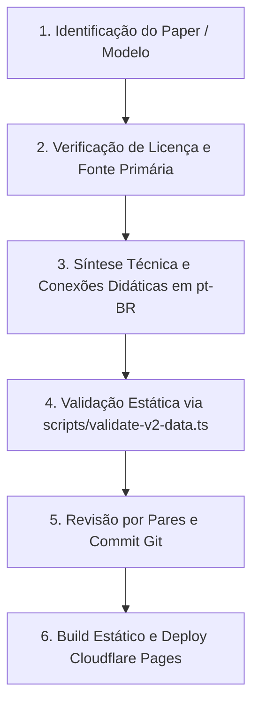

# Estratégia de Curadoria e Ingestão Científica (Versão 2.0)

Este documento estabelece formalmente a política, o fluxo operacional e a arquitetura técnica de manutenção dos dados científicos do **Centro de Pesquisa (`/pesquisa`)** e do **Observatório de IA (`/observatorio`)** na IA Engineer Academy.

---

## 1. Princípios Norteadores

1. **Snapshots Locais Auditados (Offline-First):**
   Todos os dados de artigos científicos, modelos abertos, datasets e benchmarks de serving residem em arquivos estáticos versionados no repositório Git (`content/research/` e `content/observatory/`).
2. **Ausência Total de Coletores Automatizados em Runtime:**
   A plataforma **não utiliza crawlers, scrapers ou daemons em segundo plano** em produção. Não há requisições a APIs externas em tempo de execução no Cloudflare Pages. Qualquer menção a automação de ingestão refere-se estritamente a ferramentas de auxílio ao mantenedor durante a curadoria offline local.
3. **Custo Operacional Zero (R$ 0,00):**
   Não há dependência de planos pagos, proxies rotativos ou serviços terceiros com faturamento recorrente.
4. **Auditabilidade Humana e Prevenção de Alucinação:**
   Nenhum dado é ingerido ou publicado sem conferência direta de suas fontes primárias (links para arXiv, DOI, Hugging Face Hub, LMSYS Chatbot Arena ou relatórios técnicos oficiais). É terminantemente proibido fabricar métricas, simular pontuações ou preencher lacunas com estimativas sintéticas não rotuladas.

---

## 2. Ciclo de Vida da Curadoria Científica

A adição, atualização ou depreciação de um item no Centro de Pesquisa segue o seguinte fluxo controlado:



### Etapa 1: Triagem e Relevância

O artigo ou modelo deve representar:

- Um trabalho seminal para a engenharia de IA (ex: Transformers, RAG, LoRA, FlashAttention); ou
- Uma contribuição técnica de fronteira com código ou pesos abertos verificáveis (ex: DeepSeek-V3, Llama 3.1, Qwen 2.5, vLLM).

### Etapa 2: Checagem de Licença e Proveniência

- O paper deve possuir versão de livre acesso (PDF aberto no arXiv ou DOI permanente sob licenças abertas/Creative Commons);
- O modelo ou dataset deve possuir pesos abertos e licença permissiva ou para pesquisa (Apache 2.0, MIT, Llama 3.1 Community License, etc.);
- Todas as URLs cadastradas devem utilizar obrigatoriamente o protocolo HTTPS seguro.

### Etapa 3: Elaboração Editorial

O curador formula em português técnico:

- Resumo executivo em português (`abstractPtBr`);
- Três achados-chave objetivos (`keyFindings`);
- Conexões pedagógicas explícitas com os capítulos (`chapterId`), laboratórios matemáticos interativos (`labId`) ou diagramas do Atlas (`diagramId`).

### Etapa 4: Validação Automatizada de Contratos

Antes de qualquer submissão, executa-se o script de validação de esquemas Zod:

```bash
npm run validate:v2-data
```

O script rejeita sumariamente:

- URLs inseguras ou mal formatadas;
- Identificadores fora do padrão kebab-case (`^[a-z0-9-]+$`);
- Resumos insuficientes (< 30 caracteres) ou achados vazios;
- Conexões com IDs de capítulos ou labs inexistentes na plataforma;
- Métricas de inferência com valores de TTFT, decode speed ou VRAM negativos/zerados.

### Etapa 5: Revisão Humana e Publicação

A proposta é submetida via Pull Request, inspecionada por revisão cruzada entre engenharia e auditoria, e incorporada aos artefatos estáticos da aplicação.

---

## 3. Matriz de Fontes Primárias Auditadas

| Tipo de Dado                 | Snapshot Local                          | Fontes Primárias Auditadas                                                 |
| :--------------------------- | :-------------------------------------- | :------------------------------------------------------------------------- |
| **Artigos Científicos**      | `content/research/papers.json`          | arXiv API/OAI-PMH, Europe PMC, NeurIPS, ICML, ICLR, ACL Anthology          |
| **Modelos e Datasets**       | `content/research/models-datasets.json` | Hugging Face Hub (Model Cards / Dataset Cards), Papers with Code           |
| **Capacidades e Benchmarks** | `content/observatory/benchmarks.json`   | LMSYS Chatbot Arena Leaderboard, OpenCompass, Relatórios Técnicos Oficiais |
| **Sistemas e Serving**       | `content/observatory/systems.json`      | vLLM Official Benchmarks, Artificial Analysis, llama.cpp release notes     |

---

## 4. Conclusão e Garantias

Esta estratégia assegura que a **IA Engineer Academy 2.0** permaneça:

1. **Infinitamente escalável no edge**, sem custos de banco de dados ou backend;
2. **Resiliente a quebras de terceiros**, já que o conteúdo publicado não depende da disponibilidade de APIs externas em tempo real;
3. **Confiável pedagogicamente**, permitindo que estudantes e engenheiros inspecionem exatamente a proveniência e a metodologia de cada conceito apresentado.
